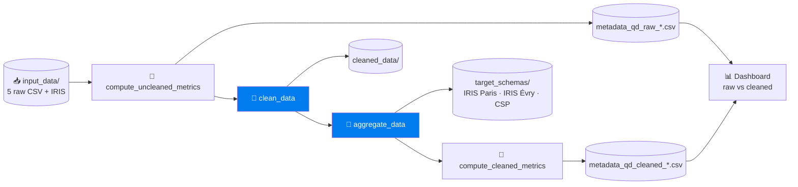
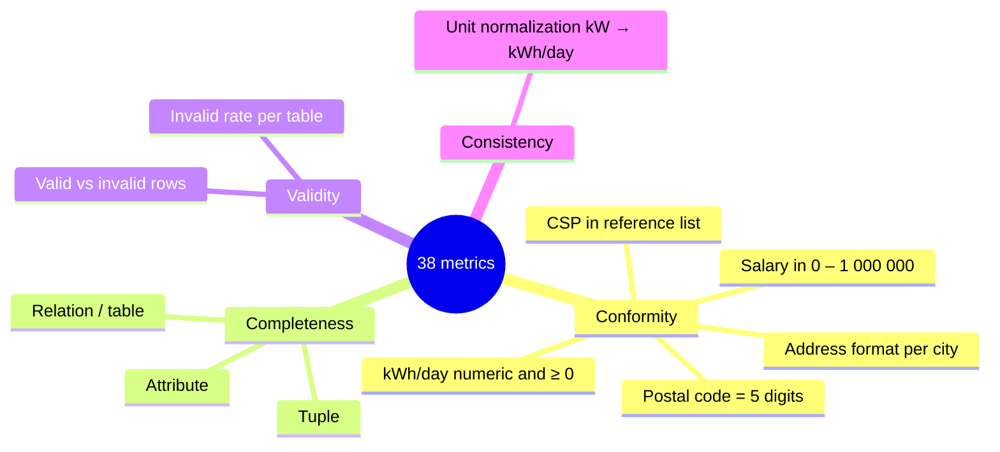
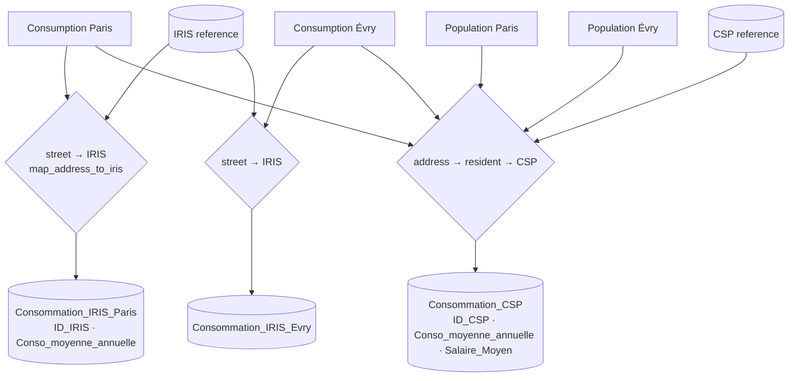

<div align="center">

# ⚡ Energy Data Quality Pipeline

**Measure → clean → integrate → re-measure: an Airflow pipeline that audits household energy-consumption data for Paris & Évry with 38 quality metrics and proves the improvement.**

[](https://www.python.org/)
[](https://airflow.apache.org/)
[](https://pandas.pydata.org/)
[](https://plotly.com/python/)
[](DATA_QUALITY_METRICS.md)
[](dashboard.html)

*Master's project — Data Quality*

</div>

---

## 📌 Table of contents

- [Problem](#-problem)
- [Pipeline](#-pipeline)
- [Quality dimensions](#-quality-dimensions)
- [Results](#-results)
- [Data integration](#-data-integration)
- [Dashboard](#-dashboard)
- [Quick start](#-quick-start)
- [Project structure](#-project-structure)

---

## 🎯 Problem

Five heterogeneous sources must be integrated to answer: *what is the average annual electricity consumption per IRIS district and per socio-professional category (CSP)?*

| Source | Content | Typical defects |
|---|---|---|
| `Consommation_Paris` | Address, postal code, daily kW | Wrong unit (kW vs kWh/day), bad postal codes |
| `Consommation_Evry` | Same, different format | Invalid postal codes, non-numeric consumption, gaps |
| `Population_Paris` | Residents, address, CSP | Malformed addresses |
| `Population_Evry` | Residents, address, CSP | Address format, CSP codes vs labels |
| `CSP` | CSP reference + mean salary | Missing salary |

---

## 🔄 Pipeline



Airflow DAG `data_quality_metrics` (`@daily`):

```
compute_uncleaned_metrics >> clean_data >> aggregate_data >> compute_cleaned_metrics
```

Every run writes **timestamped metadata snapshots**, giving a full history of quality over time.

---

## 📐 Quality dimensions



**Tuple triage:** `< 50 %` complete → excluded · `50–99 %` → imputed · `100 %` → kept as is.

### Cleaning rules (`clean_data.py`)

| Function | Fix |
|---|---|
| `clean_postal_code` | Normalize to 5 digits, reject impossible codes |
| `normalize_kw_to_kwh_per_day` | Unify consumption units |
| `standardize_address_paris / _evry` | Canonical `Ville, Numéro NomRue` |
| `standardize_csp_value` · `map_csp_numeric_to_text` | Codes ↔ labels against the reference table |
| `clean_csp_table` | Salary validation + imputation |

---

## 📊 Results

Measured on the latest raw vs cleaned snapshots (`metadata/`):

| Metric | Raw | Cleaned |
|---|:---:|:---:|
| Invalid rows — Consumption Évry | 58.33 % | **0 %** |
| Invalid rows — Consumption Paris | 100 % | **0 %** |
| Invalid postal codes — Évry | 25 % | **0 %** |
| Invalid kWh values — Évry | 41.67 % | **0 %** |
| Wrong unit — Paris | 100 % | **0 %** |
| Invalid addresses — Population Paris | 8.33 % | **0 %** |
| Invalid addresses — Population Évry | 100 % | 41.67 % |
| Invalid CSP — Population Évry | 100 % | **0 %** |
| Completeness — Consumption Évry | 90.74 % | **100 %** |
| Completeness — CSP salary | 83.33 % | **100 %** |

```mermaid
xychart-beta
    title "Invalid rate (%) — raw vs cleaned"
    x-axis ["Cons. Évry", "Cons. Paris", "CP Évry", "kWh Évry", "Addr. Pop Paris", "Addr. Pop Évry", "CSP Pop Évry"]
    y-axis "% invalid" 0 --> 100
    bar [58.33, 100, 25, 41.67, 8.33, 100, 100]
    bar [0, 0, 0, 0, 0, 41.67, 0]
```



*First bar series = raw, second = cleaned.* Remaining issue: some Évry addresses can't be repaired without an external geocoding reference — documented rather than guessed (see [`DATA_CLEANING_STRATEGY.md`](DATA_CLEANING_STRATEGY.md)).

---

## 🔗 Data integration



Issues found *after* integration are analysed in [`TARGET_SCHEMAS_ANALYSIS.md`](TARGET_SCHEMAS_ANALYSIS.md) (e.g. a duplicated IRIS caused by case sensitivity, small CSP samples).

---

## 📈 Dashboard

```bash
pip install flask flask-cors plotly                  # dashboard extras
python dags/scripts/visualize_dashboard.py --server   # → http://localhost:5050
python dags/scripts/visualize_dashboard.py            # static dashboard.html
```

Six visualizations (before/after bars, completeness gauges, quality distribution, issue breakdown, radar, table-health heatmap), a 40-metric comparison table, metadata history, and a **one-click pipeline launcher with live logs**.

---

## 🚀 Quick start

```bash
python -m venv venv && source venv/bin/activate
pip install -r requirements.txt

# Without Airflow
python dags/scripts/compute_metrics.py
python dags/scripts/clean_data.py
python dags/scripts/aggregate_data.py

# With Airflow
export AIRFLOW_HOME=$(pwd)
airflow db init
airflow webserver --port 8080 &   airflow scheduler
# → enable and trigger the DAG "data_quality_metrics"
```

---

## 📁 Project structure

```
.
├── dags/
│   ├── data_quality_dag.py          # 4-task Airflow DAG
│   └── scripts/
│       ├── compute_metrics.py       # 38 quality metrics
│       ├── clean_data.py            # Cleaning & standardization
│       ├── aggregate_data.py        # Integration into target schemas
│       ├── compare_metrics.py       # Raw vs cleaned comparison
│       └── visualize_dashboard.py · dashboard_server.py
├── input_data/                      # Raw sources + IRIS reference
├── cleaned_data/                    # Cleaned tables
├── target_schemas/                  # Final integrated outputs
├── metadata/                        # Timestamped quality snapshots
├── rapport.tex                      # Academic report
└── *.md                             # Metrics, rules, strategy, schema analysis
```

---

<div align="center">

**Mohamed Abi** · [GitHub @mohamedabi17](https://github.com/mohamedabi17)

</div>
